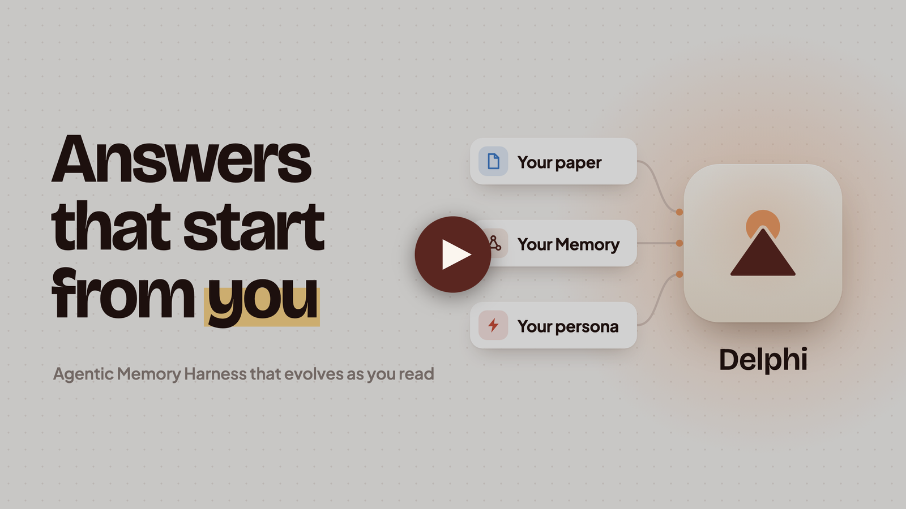
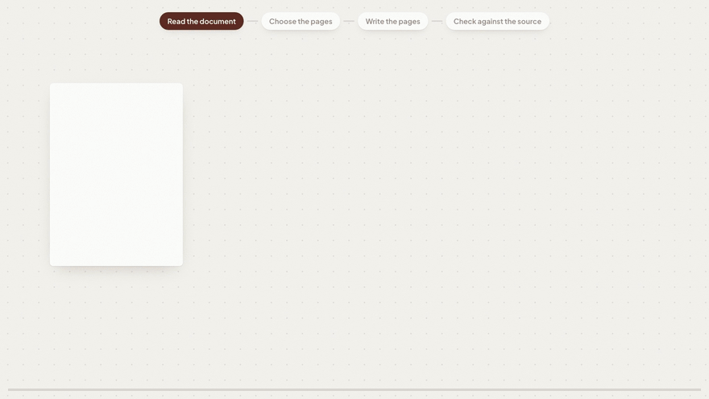
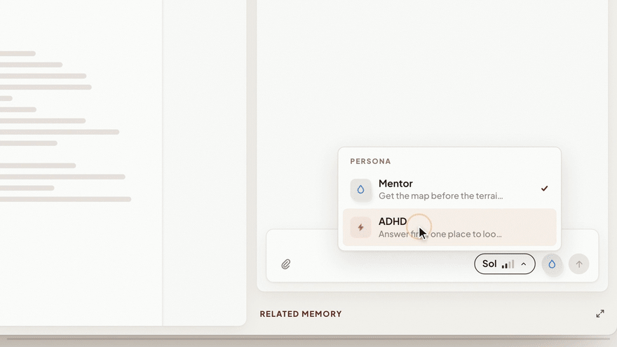

<div align="center">

<p><picture>
  <source media="(prefers-color-scheme: dark)" srcset=".github/readme/banner-dark.svg">
  
</picture></p>

</div>

## Demo

<a href="https://www.youtube.com/watch?v=u8ALOOZ988k"></a>

<p align="center"><sub><a href="https://www.youtube.com/watch?v=u8ALOOZ988k">Watch the 2min demo on YouTube</a></sub></p>

## Getting started

### Install the app

Delphi runs on Apple silicon Macs with macOS 14 or later. Connect it to a
ChatGPT or Claude plan, or an OpenAI or Claude API key.

1. Download the DMG from [Releases](../../releases) and drag **Delphi** into
   **Applications**. If a release has no DMG, [build Delphi from
   source](#build-from-source) instead.
2. Open Delphi. macOS blocks the first open because Delphi isn't notarized:
   go to **System Settings → Privacy & Security** and click **Open Anyway**.
3. Choose your connection.

Your documents go only to the model provider you connect; there is no Delphi
server. Something broke? **Help → Report a Bug…**

### Build from source

You need npm (Node.js 22.13 or later).

```bash
git clone https://github.com/thekevinli/delphi.git
cd delphi/desktop
npm install
npm run build   # several minutes the first time
npm start       # run it
npm run dist    # or package Delphi.app and a DMG
```

Clone outside an iCloud-synced folder; a ZIP download won't build.

## Memory harness

Memory is a wiki Delphi writes from your documents and conversations, and
reads before it answers.

**Filing a document.** Delphi chooses the pages a new document bears on, edits
them and writes new ones, then checks each against the passage it cites.

<p></p>

**A chat turn.** Delphi picks the pages that bear on your question by meaning,
so the answer builds on what you have read and skips what you already know.

<p></p>

When you leave a chat, whatever it added that Memory lacked is filed the same way.

## Agentic reader UI

The reader has three columns: your project's library, the open document, and
the chat above the Related Memory rail.

**PDFs** open in a PDF.js reader where you can select and find text; scanned
PDFs are not OCR'd. **Web pages** are added by pasting a link. Delphi keeps a
snapshot cut into sections, and shows the live page in a sandboxed frame on a
separate local hostname, so the page never sees Delphi's session cookie.
**View cached** shows the kept copy. Delphi does not get past paywalls or bot
detection.

Every document gets a **research digest**: notes that follow it, with exact
equations and figures captured from it.

Select text in either kind of document to **Highlight** it, add a **Note**, or
**Reply**, which asks about the passage. A web highlight is anchored by its
exact quote, so it survives changes to the page.

A chat beside a document carries that document, the project's digests and the
Memory pages chosen for the question; switch its scope between **Project** and
**Memory**. A citation such as "(Paper, Table 1, p. 19)" is a link: Delphi
opens the document and finds the table as the PDF prints it, or lands on the
cited page. ⌘K searches your whole library.

**Diagrams** sit inside chat answers. The agent describes a diagram as data
and Delphi draws it from its own library of flows, charts, matrices, grids and
timelines, so every diagram looks like Delphi and fits the chat at any width.
Before delivery the agent sees every step at each width and repairs what is
cut off or never shown. A stepped explanation has Back/Next and a step track
in its header. Runtime checks do not establish scientific correctness.

## MCP coding agent handoff

In any chat, press **Shift+Tab** to switch to **Plan**, then ask, for example:
*"Method A in this paper seems most useful. Create a plan to reproduce it."*
Only this switch creates a plan. Delphi checks the plan against its schema and
saves it, then replies with a link to the plan page and a `plan_id`.

A plan states the question, then **Table 1**: runs as rows and settings as
columns, with the decisive cells marked, so you can ask Codex for "runs (1),
(3) in setting (a)". It fixes the setup, labelling each choice as from a
source, from you, or proposed; says how to read each outcome; and quotes its
references, with up to three captured PDF pages. The page is static HTML on
`localhost`, with no scripts. Delphi keeps three active plans and asks which to
archive when you make a fourth.

### Hand it to Codex

```sh
codex mcp add delphi -- "$HOME/.local/bin/delphi-mcp"
```

Delphi installs that launcher with your first plan, or from
**Help → Set Up Delphi MCP**. In a new Codex session, paste the line Delphi
gives you:

> Use Delphi MCP plan `<plan_id>`. Implement runs (1), (3) in setting (a). Hold Setup fixed and ask before changing it.

Codex gets two read-only tools: `get_plan` for the plan, and
`read_plan_source` for the captured text and pages of its sources. The
connection is a local bridge over a private socket, with no network port and
no write-back; keep Delphi open while Codex reads. [MCP.md](MCP.md) has the
details.
